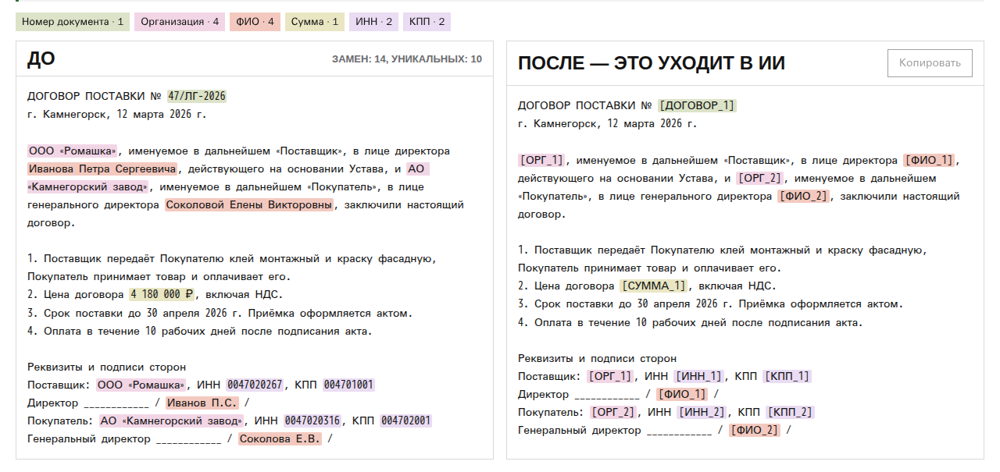
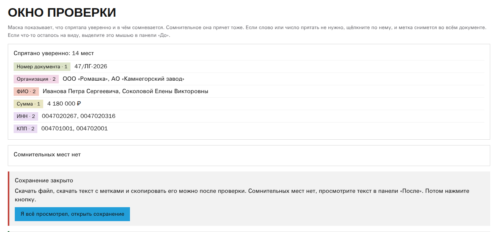
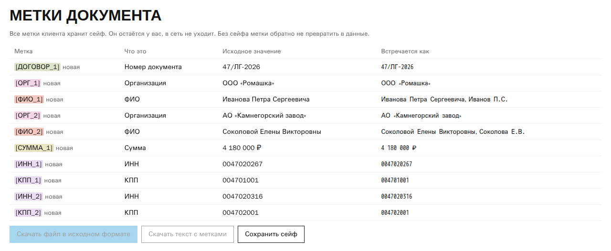
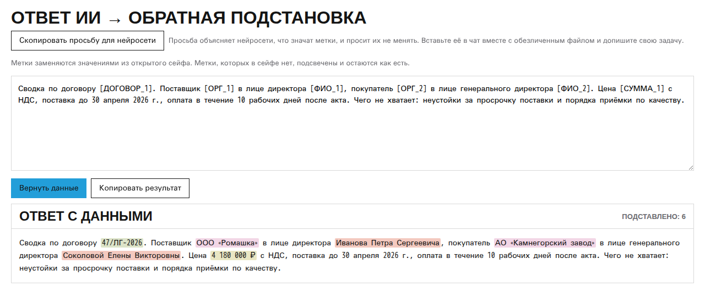

# Маска

Маска убирает из договоров, актов, писем и выгрузок 1С ФИО, ИНН, счета, телефоны и адреса, чтобы документ можно было отдать нейросети. Суммы прячутся по выбору. Метки общие на всю пачку документов одного дела, а ответ нейросети возвращается с настоящими значениями. Обезличенный docx или xlsx скачивается в исходном виде, с форматированием и формулами. Вся работа идёт в браузере, это один файл `index.html`, и в сеть он ничего не отправляет.

Попробовать без установки: https://alexandrkomarov.com/tools/maska/. Поставить у себя: [docs/install.md](docs/install.md).



## Зачем

Я веду программы по ИИ для сотрудников без технической подготовки. На них учатся юристы, кадровики, закупщики, бухгалтеры, специалисты по реестрам и документообороту, служба качества, инженеры и начальники цехов. Их рабочие задачи завязаны на документы, а правила компании часто запрещают отправлять наружу данные контрагентов и сотрудников. Инженеры капстроительства спросили так: как обезличить сотню договоров по 223-ФЗ и разобрать их в ИИ, если у них «запрещено всё».

Маска заменяет эти данные метками до отправки. Нейросеть видит структуру договора и условия, но не видит, с кем он заключён.

Метки одинаковые во всех документах одного дела. Если «Северный Терминал» в договоре стал `[ОРГ_1]`, в акте и в акте сверки он тоже `[ОРГ_1]`. Поэтому нейросеть может сопоставлять документы между собой, а ответ с метками Маска превращает обратно в текст с названиями и фамилиями.

## Как это выглядит

Документ до Маски (данные вымышлены):

```text
ДОГОВОР ПОДРЯДА № 41-КВ/2025 от 12.03.2025
ООО «Северный Терминал» (ИНН 7729654321), в лице генерального директора Кузнецовой Марины Олеговны,
и ИП Лаптев Михаил Андреевич заключили договор о ремонте кровли склада по адресу:
г. Санкт-Петербург, ул. Кирова, д. 12.
Цена работ 1 468 800,00 руб. Оплата на счёт 40702810900000012345 в течение 10 рабочих дней
после подписания акта. Контакт подрядчика: +7 (921) 555-01-23, m.laptev@laptev.example.
```

То, что уходит в нейросеть:

```text
ДОГОВОР ПОДРЯДА № [ДОГОВОР_1] от 12.03.2025
[ОРГ_1] (ИНН [ИНН_1]), в лице генерального директора [ФИО_1],
и ИП [ФИО_2] заключили договор о ремонте кровли склада по адресу:
г. Санкт-Петербург, [АДРЕС_1].
Цена работ [СУММА_1] Оплата на счёт [СЧЁТ_1] в течение 10 рабочих дней
после подписания акта. Контакт подрядчика: [ТЕЛ_1], [ПОЧТА_1].
```

Даты договоров, город, сроки и предмет остаются на месте, без них нейросети нечего анализировать. Без галочки «прятать суммы» строка «Цена работ 1 468 800,00 руб.» осталась бы как есть.

## Как работать

1. Загрузить файл или вставить текст. Маска читает docx, xlsx, csv, txt и md. Старые doc и xls нужно пересохранить в docx и xlsx. Галочкой «прятать суммы» решают, видит ли нейросеть цены и суммы.
2. Просмотреть результат в окне проверки. Маска показывает отдельно, что спрятала уверенно и в чём сомневается. Сомнительное тоже спрятано. Щелчок по метке снимает её во всём документе. То, что осталось на виду, выделяется мышью. Сохранение открывается только после просмотра.

   

3. Скачать файл в исходном формате (docx остаётся docx, xlsx остаётся xlsx, с форматированием и формулами) или текст с метками. Отправить в нейросеть вместе с готовой просьбой не трогать метки, её даёт кнопка «Скопировать просьбу для нейросети».

   

4. Вставить ответ нейросети и нажать «Вернуть данные». Метки заменятся настоящими значениями.

   

Соответствие меток и значений хранит сейф. Это файл `<название>.сейф.json`, который человек сохраняет у себя. Один сейф ведут на клиента или дело, и тогда пачка документов получает общие метки. Без сейфа метки обратно в данные не превратить. В сейфе лежат настоящие значения, хранить его нужно так же, как сами документы.

Названия фирм без ООО, АО или ИП Маска сама не находит. Их, а также названия проектов и объектов, вписывают в поле «Что ещё спрятать». Слова сохраняются в сейфе и ищутся во всех следующих документах.

## Что прячется

| Метка | Что |
|---|---|
| `[ФИО_1]` | фамилия, имя, отчество, в том числе с инициалами и в падежах |
| `[ОРГ_1]` | организация с формой собственности и названия из поля «Что ещё спрятать» |
| `[ИНН_1]`, `[КПП_1]`, `[ОГРН_1]`, `[БИК_1]`, `[СНИЛС_1]` | реквизиты, ИНН и без подписи по контрольной сумме |
| `[СЧЁТ_1]`, `[КАРТА_1]` | расчётные счета и номера карт |
| `[ПАСПОРТ_1]`, `[РОЖДЕНИЕ_1]`, `[ДАТА_1]` | паспорт, дата рождения, дата выдачи паспорта |
| `[ТЕЛ_1]`, `[ПОЧТА_1]`, `[НИК_1]`, `[АДРЕС_1]` | контакты и адреса |
| `[ДОГОВОР_1]` | номера договоров, счетов и документов 1С |
| `[СУММА_1]` | суммы цифрами и прописью, если стоит галочка «прятать суммы». Для текста и docx она включена по умолчанию, для xlsx и csv выключена, переключается в любом файле |

## Где Маска ошибается

Маска работает на правилах и регулярных выражениях, без модели. Один и тот же документ всегда даёт одни и те же метки, книга Excel на 417 тысяч ячеек читается за 0,6 секунды (замер в Node). На контрольном наборе из семи вымышленных деловых документов она спрятала 95 значений из 95 и не задела лишнего в 94 случаях из 94. Этот набор писал тот же автор, что и правила, поэтому промахи на чужих документах будут. Типовые ошибки такие:

- ФИО ищется эвристикой. Редкую фамилию без имени и отчества она может пропустить, а слово с заглавной буквы принять за фамилию. Поэтому окно проверки обязательно.
- Фирма без формы собственности, которая ни разу не встретилась с ООО или АО, не найдётся, если её не вписать в «Что ещё спрятать».
- Любое десятизначное число с верной контрольной суммой (примерно каждое десятое) прячется как ИНН.
- Внутренние коды в ячейке таблицы вида `ТП-10` или `Z000000000` прячутся как номера документов.

Полный список пропусков и ложных срабатываний с замерами лежит в [docs/rules-v2.md](docs/rules-v2.md).

## Для ИТ и безопасности

Маска написана так, чтобы её можно было поставить во внутренний контур и проверить за один вечер.

- `index.html` весит около 200 КБ, внутри разметка, стили и скрипт. Внешних скриптов, шрифтов, картинок и библиотек нет. Для запуска ничего собирать и устанавливать не нужно.
- В начале `<head>` стоит политика безопасности контента (CSP), она запрещает странице сеть:

  ```html
  <meta http-equiv="Content-Security-Policy" content="default-src 'none'; script-src 'unsafe-inline'; style-src 'unsafe-inline'; img-src data:; connect-src 'none'; form-action 'none'; base-uri 'none'">
  ```

  С ней браузер сам блокирует любой запрос страницы наружу, отправку форм и загрузку чужого кода. Если в файл кто-то допишет `fetch`, браузер его не выполнит.
- Страница ничего не хранит и не пишет в `localStorage`, `IndexedDB` и cookie. Документ живёт в памяти вкладки до её закрытия. Сейф и обезличенные файлы человек скачивает сам.
- Ссылки на сайт автора стоят только в `canonical`, `og:` и schema.org для поисковиков и в подвале. Браузер по ним сам не ходит.

### Как поставить

Скопировать `index.html` и открыть его с диска в современном браузере или положить на внутренний веб-сервер как статическую страницу. Обновление делается заменой файла. Подробно, с версиями браузеров, конфигами nginx и IIS и тем, что сказать пользователям: [docs/install.md](docs/install.md).

### Как проверить

- Открыть страницу, в инструментах разработчика на вкладке Network загрузить документ. Запросов, кроме самого файла, не будет.
- В консоли выполнить `fetch('https://example.com')`. Браузер откажет с нарушением `connect-src`.
- Прочитать код. Логика чтения и сборки docx и xlsx лежит в `src/`, `build.mjs` вставляет её в `index.html`. Команда `node build.mjs --check` проверяет, что блок в `index.html` совпадает с `src/`. Правила поиска и интерфейс написаны прямо в `index.html`.
- Прогнать тесты (ниже). Тест `tests/page.test.mjs` ищет в странице внешние адреса и сетевые вызовы и проверяет, что CSP на месте.
- Сверить файл с выложенным на сайте: `sha256sum index.html` против `curl -s https://alexandrkomarov.com/tools/maska/ | sha256sum`.

## Разработка

Зависимостей нет, нужен только Node.js (проверено на версии 24).

```sh
node build.mjs --check          # блок модулей в index.html совпадает с src/
node build.mjs                  # пересобрать блок после правки src/
node --test tests/*.test.mjs    # все тесты
node tests/harness.mjs          # замер правил на текстовых наборах
node tests/harness-files.mjs    # замер на docx и xlsx
```

Тесты, которые открывают результат в LibreOffice, без `soffice` пропускаются.

| Путь | Что лежит |
|---|---|
| `index.html` | страница целиком: правила поиска, интерфейс, собранный блок модулей |
| `src/` | чтение и возврат docx и xlsx, zip, сейф |
| `tests/` | тесты и наборы с разметкой: что должно спрятаться и что должно остаться |
| `docs/` | описание правил, сейфа, чтения и возврата файлов, замеры |

Все данные в `tests/` вымышлены: ФИО, организации, адреса и телефоны придуманы, ИНН и счета посчитаны по алгоритмам контрольных сумм, почта на домене `.example`. Совпадение с настоящим человеком или организацией случайно. Настоящие документы, на которых мерили правила, в репозиторий не попали.

## Лицензия

[MIT](LICENSE).

Александр Комаров - ИИ-тренер и консультант по внедрению ИИ, преподаватель Учебного центра Softline. alexandrkomarov.com
